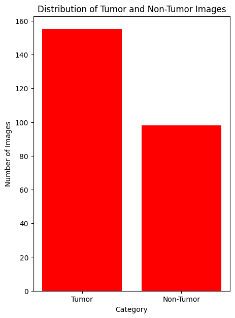
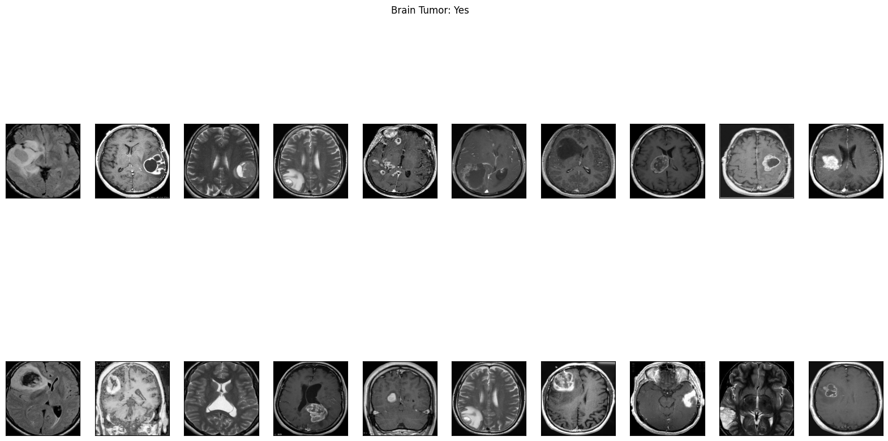
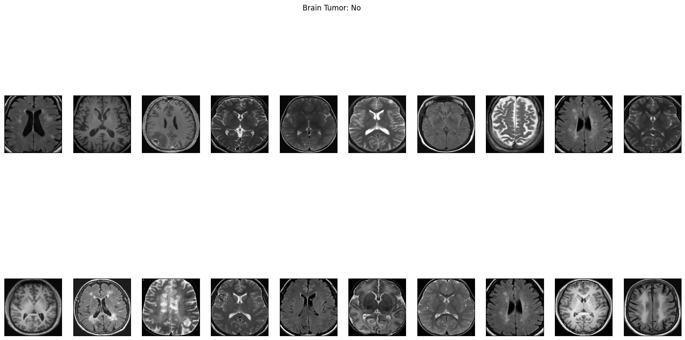
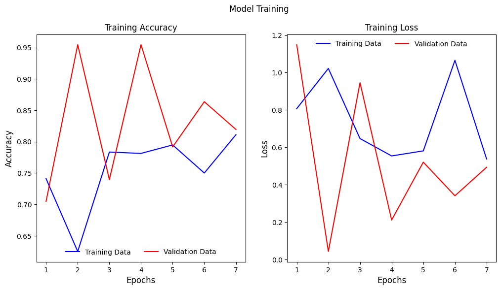

# Brain Tumour Detection from MRI Images using Deep Learning (VGG19)

MSc Computer Science dissertation project, Teesside University (2024).

This project uses **transfer learning with a VGG19 convolutional neural network** to classify brain MRI scans as **tumour** or **no tumour**. It also includes a simple **Flask web app** where a user can upload an MRI image and get an instant prediction.

---

## Dataset

- **253 brain MRI images** in two classes: **155 tumour** ("yes") and **98 no tumour** ("no").
- Source: the public Kaggle dataset *Brain MRI Images for Brain Tumor Detection*. The dataset itself is **not included** in this repository.



| Tumour | No tumour |
|--------|-----------|
|  |  |

## Method

1. **Pre-processing.** Files are renamed, images are resized to 240×240, and the brain region is cropped out of each scan using OpenCV contour detection.
2. **Data augmentation.** Rotation, shifts, zoom and flips expand the small dataset to about 1,800 images (about 1,445 for training, 310 for validation and 57 for testing).
3. **Model.** VGG19 pre-trained on ImageNet, with a new classification head (Flatten → Dense → Dropout → output) that is fine-tuned on the MRI data.
4. **Training.** Early stopping, model checkpointing and learning-rate reduction (ReduceLROnPlateau) are used to limit overfitting.
5. **Deployment.** A Flask app (exposed with ngrok in Google Colab) loads the trained model and returns a prediction for any uploaded image.

## Results

Two VGG19-based models were trained and compared.

| Model | Training accuracy | Validation accuracy | Test accuracy |
|-------|------------------|---------------------|---------------|
| Model 1 | 69.5% | 74.2% | 71.4% |
| **Model 2 (best)** | **82.8%** | **81.9%** | – |

**Model 2 training curves:**



**What the results show:** Model 2 generalised better, with lower validation loss. However, the curves move around a lot from epoch to epoch, because the original dataset is small (253 images). The model would need more data and a more stable validation set before it could be relied on.

## Tech Stack

Python · TensorFlow / Keras · VGG19 (transfer learning) · OpenCV · NumPy · scikit-learn · Matplotlib · Flask · pyngrok · Google Colab

## Repository Structure

```
brain_tumour_classification.ipynb   # full pipeline: pre-processing, training, evaluation, Flask app
requirements.txt                    # Python libraries
images/                             # figures used in this README
```

## How to Run

1. Open `brain_tumour_classification.ipynb` in **Google Colab** (or in Jupyter with a GPU).
2. Download the Kaggle dataset as `archive.zip` and upload it next to the notebook.
3. Install the libraries:
   ```bash
   pip install -r requirements.txt
   ```
4. Run the cells in order to pre-process the data, train the models and evaluate them.
5. For the web app, add **your own** ngrok authtoken in the marked cell, then run the Flask cell and open the ngrok link.

## Limitations and Future Work

- The dataset is small, so a larger dataset (such as BraTS, or a multi-class glioma, meningioma and pituitary dataset) would give more reliable results.
- Report a full confusion matrix, precision, recall and F1-score on a held-out test set.
- Try other architectures, such as ResNet or EfficientNet, and use cross-validation.
- Add explainability, such as Grad-CAM heatmaps, so that clinicians can see which regions the model uses.

> This is an academic project. It is **not** a medical diagnostic tool.

## Author

**Vaibhav Bhalani** · MSc Computer Science, Teesside University
Supervisor: Shawn Robertson
[LinkedIn](https://linkedin.com/in/vaibhavbhalani)
